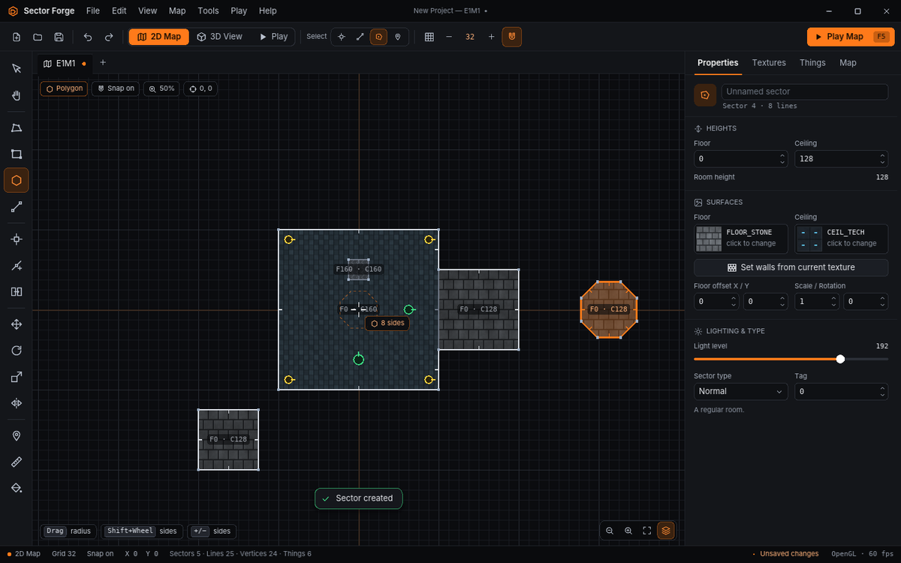
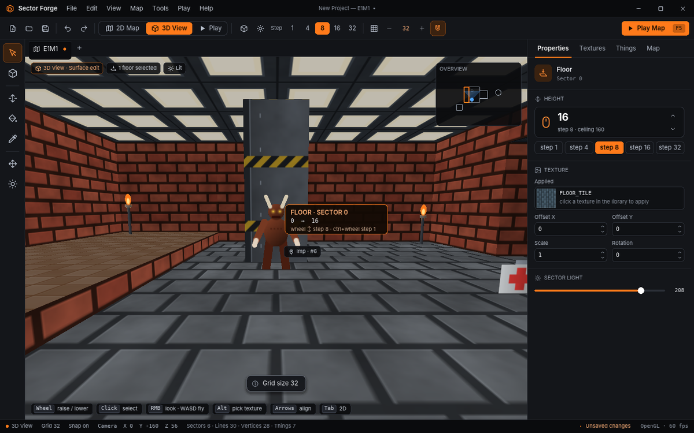
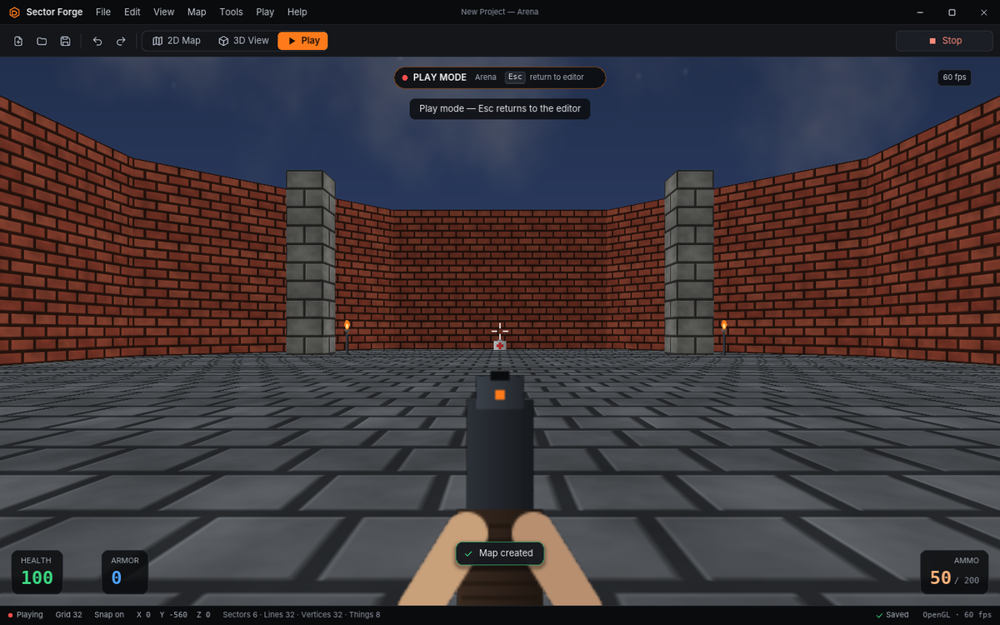
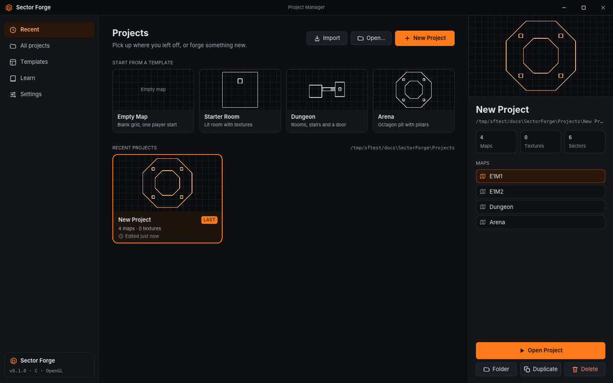

# Sector Forge

**A Doom-style sector map editor and game engine for Windows.** Build maps in 2D, texture and shape them in a live 3D view, and play them instantly. It is written in C11 on Win32 and OpenGL, with no outside dependencies.



| 3D view: select a floor, scroll to raise it | Play mode |
| --- | --- |
|  |  |



<sub>These screenshots are preview renders from the headless test harness (`tests/`). The Windows build looks the same, using Segoe UI and Consolas.</sub>

---

## Download

* **Latest build:** open the [Actions](../../actions) tab, pick the newest green **Build** run and download **SectorForge-windows-x64**. It contains `SectorForge.exe` plus `vcruntime140.dll`; keep them in the same folder. No installer needed.
* **Releases:** pushing a `v*` tag publishes a zip on the Releases page.

Requirements: Windows 10 or 11 (64-bit) and any GPU driver with OpenGL 1.1 or newer, which means every Windows PC.

## Features

### App
* **Borderless dark window** with a custom title bar, File/Edit/View/Map/Tools/Play/Help menus, and minimise/maximise/close buttons. Dragging, double-click to maximise, edge resizing and Aero Snap all work.
* **Per-monitor DPI aware:** the UI and fonts stay crisp at any scaling.
* **Load screen:** generates the texture library, sprites and icon atlas at startup.
* **Project manager:**
  * Recent and all projects with live map thumbnails.
  * Four templates: Empty, Starter Room, Dungeon, Arena.
  * New / Open / Import projects; open folder, duplicate, and delete (to the Recycle Bin).
  * A Learn page and a Settings page.
* **Project loading screen**, then the editor.
* **Full icon set:** 80 vector icons rasterised into an anti-aliased atlas at startup.

### 2D sector editing
* **Drawing tools:**
  * **Draw Sector:** click corners, then double-click or click the first point to close.
  * **Rectangle** and **Polygon / Circle** (3–64 sides).
  * **Draw Lines:** split a sector with a line.
* **Automatic topology:**
  * Rooms drawn against each other join through two-sided lines.
  * A shape drawn inside a sector becomes an inner sector (pillar, pit or platform) and inherits the outer sector's properties.
  * Crossing lines are split and holes are handled.
* **Selection modes:** vertices, lines, sectors and things (`1`–`4`). Click, Shift-add, Ctrl-toggle and box select are supported.
* **Edit tools:**
  * Move, Rotate (15° snaps) and Scale, with automatic welding when vertices land on each other.
  * Insert Vertex, Split Line, Join / Merge sectors, Flip lines, Mirror, Rotate 90°.
  * Copy / Cut / Paste / Duplicate and arrow-key nudging.
* **Grid tool:**
  * Sizes from 1 to 512 or a custom size; set the major line spacing.
  * Snap to grid, and snap to vertices and lines.
  * Toggles for line lengths and sector heights; `[` and `]` change the size.
* **More tools:** Place Thing (drag to aim), Measure, Paint Texture (with eyedropper).
* **Viewing:** textured floors in 2D, sector labels, front-side ticks and a right-click context menu.
* **Properties panel:**
  * Sector: name, floor/ceiling heights, floor/ceiling textures, offsets, scale, rotation, light, type and tag.
  * Line: flags and per-side textures and offsets.
  * Vertex: position. Thing: type, angle and position.
  * Multi-selection editing, with mixed values shown as "—".
* **History:** undo/redo with 200 steps, and autosave.

### 3D view
* **Fly camera:** hold the right mouse button to look, then WASD, Q/E and Shift for speed.
* **Pixel-accurate picking** of floors, ceilings, upper/middle/lower walls and things, using an ID buffer.
* **Mouse wheel raises or lowers** the selected floor or ceiling: step 1, 4, 8, 16 or 32, or Ctrl+wheel for a step of 1. A live "height 32 → 40" label shows the change.
* **Texturing:** click a texture in the library to apply it. Alt+click picks a texture and `P` pastes it. Arrow keys align, and there is scale and rotation per floor or ceiling.
* **Display:** sector lighting, fake contrast, distance fog, animated liquids, sky ceilings (`F_SKY`), sprite things, fullbright and wireframe modes, and a minimap overview.

### Play mode (F5)
* **Movement:** mouse look, WASD, run, jump and crouch.
* **Collision:** step-up onto ledges, gravity and ceiling clearance.
* **Sector types:**
  * **Doors:** draw them open; they start closed and `E` opens them.
  * **Lifts**, damage floors (lava), secrets, flickering lights and exit sectors.
* **Combat and pickups:** hitscan shooting, enemies that can be shot down, and health / armour / ammo pickups. There is a HUD and a level-complete screen with kills, items, secrets and time.
* **Starting point:** start from the player start, or from the 3D camera with Shift+F5.

### Textures
* **42 procedural textures:** bricks, stone, metal, tech, wood, marble, tiles, grass, water, slime, lava and sky.
* **Import your own PNG, JPG, BMP, GIF or TGA files** (Textures → Import). They are copied into the project's `textures/` folder.

## Quick start
1. **New Project** → choose *Starter Room* → **Create**.
2. Press **D** and click out a room touching the existing one. Double-click to close it.
3. Press **Tab** for 3D. Click the new floor and scroll the wheel to raise it into a platform.
4. Open the **Textures** tab and click a texture to apply it to the selected surface.
5. Press **F5** to play, and **Esc** to come back.

Press **F1** in the editor for all keyboard shortcuts.

## Files
```
Documents\SectorForge\Projects\<Project>\
    project.sfproj     project name, map list, defaults (text)
    maps\map01.sfmap   map: vertices, sectors, lines (two sides), things, camera (text)
    textures\*.png     imported textures (file name = texture name)
```
Both formats are plain text, so they work well with version control.

## Building from source
Visual Studio 2022 (Desktop C++ workload) and CMake 3.16+:
```
cmake -S . -B build -G "Visual Studio 17 2022" -A x64
cmake --build build --config Release
```
This produces `build/Release/SectorForge.exe`. MinGW-w64 also works (`cmake -G "MinGW Makefiles"`).

## Source layout
| File | Purpose |
| --- | --- |
| `src/map.c`, `mapio.c` | Sector map model, half-edge face tracing, draw/split/delete/move/join operations, templates, `.sfmap` format |
| `src/render3d.c` | GL 1.1 sector renderer: GLU-tessellated flats, walls with pegging, sky, sprites, ID-buffer picking |
| `src/ed2d.c`, `ed3d.c`, `play.c` | 2D tools, 3D surface editing, play-mode physics and specials |
| `src/panels.c`, `app.c` | Toolbar, tool rail, property/texture/thing/map panels, menus, dialogs, splash, project manager |
| `src/ui.c`, `gfx.c` | Immediate-mode UI toolkit and 2D drawing layer |
| `src/texgen.c`, `icons.c`, `assets.c` | Procedural textures and sprites, vector icon rasteriser, asset library |
| `src/win32.c` | Win32 platform layer: borderless window, WGL with MSAA, raw input, GDI fonts, WIC images, shell file operations |

## Tests
* `tests/test_map.c`: unit tests for the map core. They run on Linux in CI under AddressSanitizer.
* `tests/run_harness.sh`: a headless harness that drives the **whole app** with scripted mouse and keyboard input under ASan/UBSan, using a software OpenGL stand-in. It covers creating a project, drawing sectors, the 3D wheel, play mode, maps, dialogs and reopening. Set `SF_SHOTS=1` to dump screenshots.

## "Trojan:Win32/Wacatac" warnings
New, unsigned hobby builds are sometimes flagged by Defender's machine-learning heuristics (names ending in `!ml`). Sector Forge is built from this repository's source by GitHub Actions. If it is flagged, restore it from **Windows Security → Protection history → Allow on device**, and report it at <https://www.microsoft.com/wdsi/filesubmission> as "Incorrectly detected as malware". Signing releases with a code-signing certificate removes these warnings for good.
